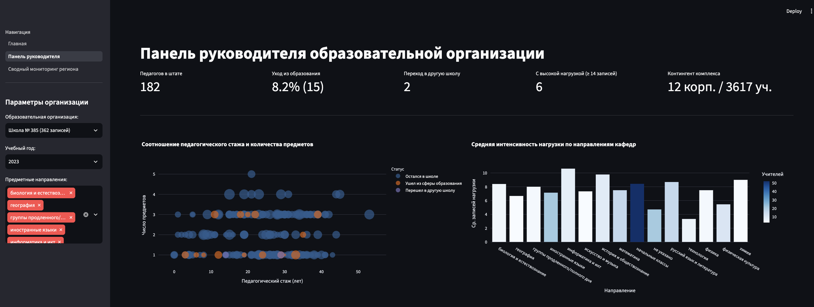

# Мониторинг кадровой динамики педагогов

Репозиторий содержит файл с препроцессингом, EDA данных и интерактивный прототип многостраничной СППР
## Структура проекта

```text
dss/
├── data/
│   └── dataset.csv              # подготовленный датасет для дашборда
├── pages/
│   ├── dashboard_director.py    # панель руководителя образовательной организации
│   └── dashboard_department.py  # сводный мониторинг органа управления образованием
├── start.py                     # главная страница приложения и настройка навигации
├── EDA.ipynb                    # ноутбук с препроцессированием данных
├── requirements.txt             # зависимости
├── director_page.png      # скрин панели руководителя
└── department_page.png    # скрин панели регионального мониторинга

Пользовательские сценарии
1) Руководитель образовательной организации:
- Выбор конкретной школы из отсортированного по размеру штата списка и учебного года
- Оценка кадровой устойчивости: численность коллектива, процент оттока, количество педагогов с высокой нагрузкой
- Точечный анализ соотношения педагогического стажа и числа предметов.
- Распределение средней нагрузки по предметным кафедрам школы.

2) Орган управления образованием:
- Региональный срез с фильтрацией по учебному году, округам и минимальному размеру штата (нужен для отсечения очень маленьких организаций)
- Межшкольное сопоставление — зависимость процента текучести школы от средней учебной нагрузки на учителя
- Сравнение округов по доле выбытия педагогов и доле специалистов с высшей квалификационной категорией.

#### Панель руководителя образовательной организации


#### Сводный региональный мониторинг органа управления
